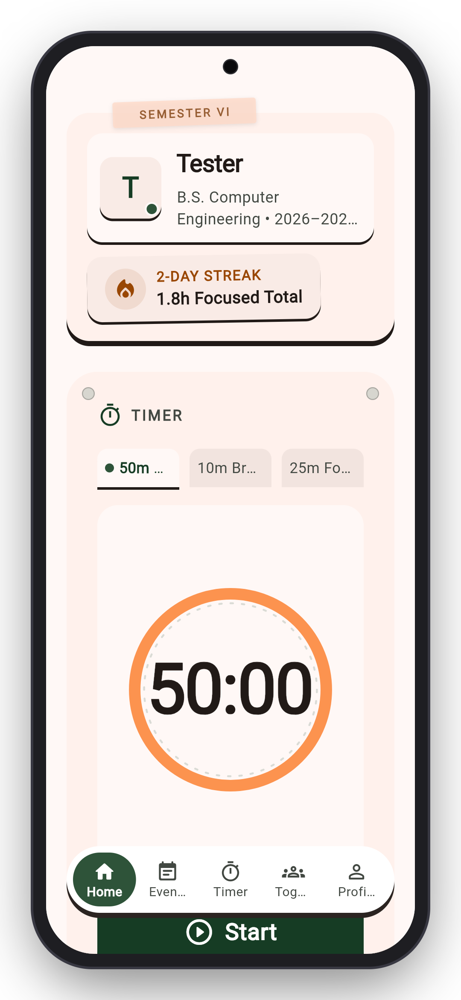
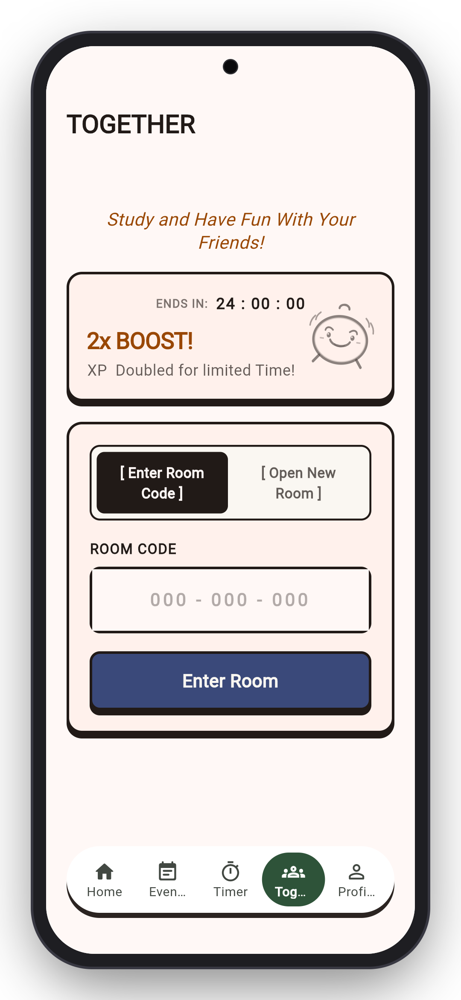
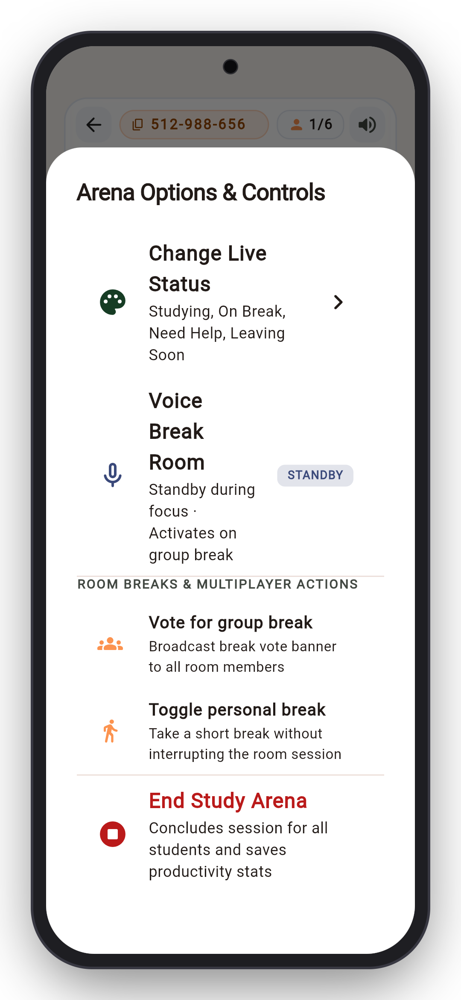
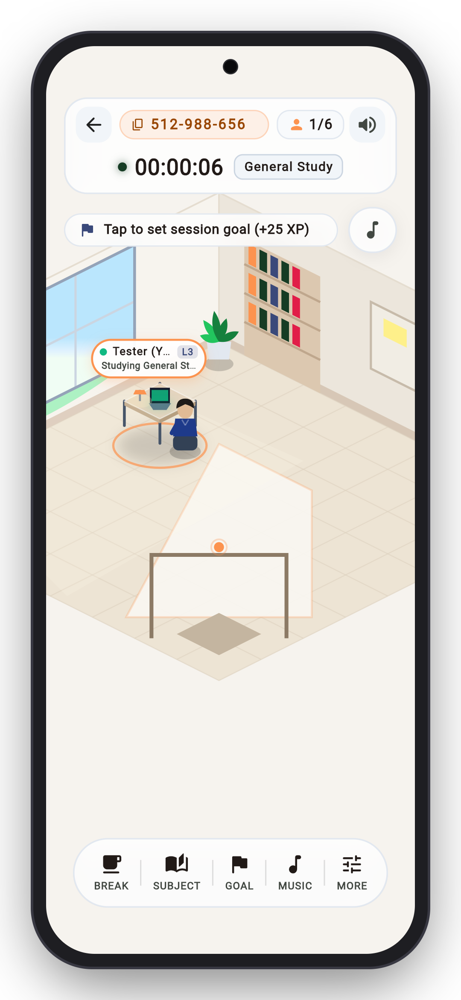
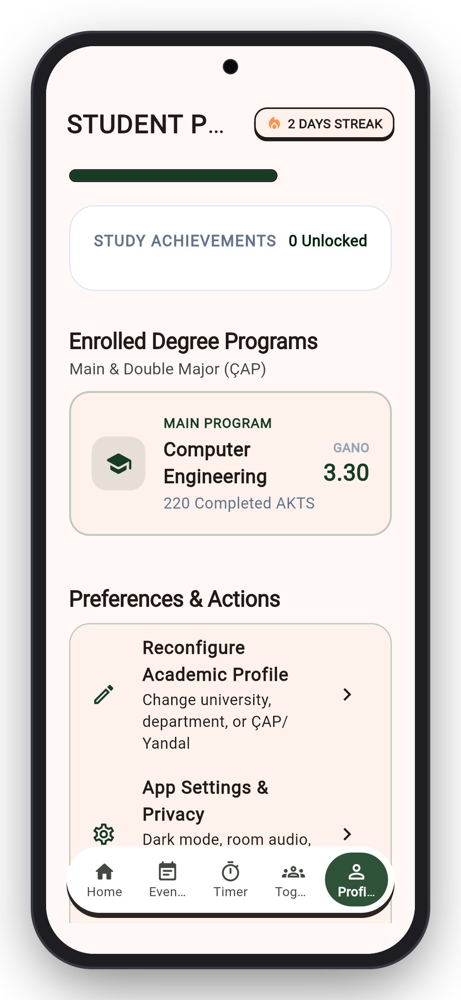
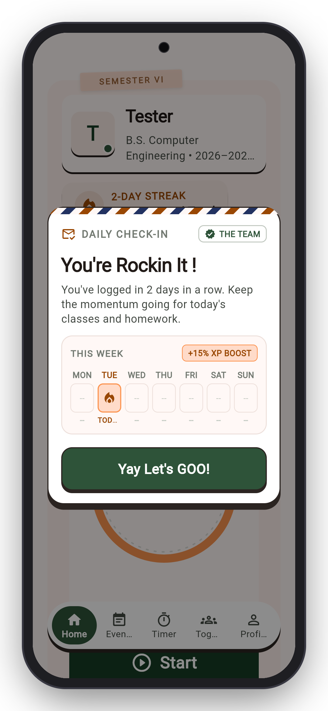

  

  # UniFocus
  **Academic & Social Productivity Platform**

  

    
    
    
    
    
    
  

  

    
  

  

    <b>Türkçe</b> • <a href="README_EN.md">English</a> • <a href="README_AR.md">العربية</a>
  

  

    <a href="#-user-perspective">User Perspective</a> •
    <a href="#️-technology-stack">Tech Stack</a> •
    <a href="#-25d-isometric-workspace-architecture">2.5D Room Engine</a> •
    <a href="#-academic-engine--gpa-matrix">Academic Engine</a> •
    <a href="#-gamification--break-mini-games">Gamification</a> •
    <a href="#-performance-load--concurrency-testing">Performance & Tests</a>
  

---

---

## 🎯 Kullanıcı Gözünden UniFocus

UniFocus; ders takibini, günlük görev yönetimini ve gerçek zamanlı çok oyunculu çalışma ortamını hem üniversite hem de okul öğrencileri için tek bir işbirliği platformunda bir araya getirir.

### 1. Üniversite Öğrencileri İçin
- **Tüm Akademik Sürecinizi Takip Edin:** Her dönem sıfırdan hesaplama yapma zahmetine girmeden mevcut derslerinizi, güncel GANO'nuzu ve tamamlanan AKTS kredilerinizi girerek mezuniyet ilerlemenizi ve akademik analizlerinizi görüntüleyin.
- **Çift Anadal (ÇAP) ve Yandal Entegrasyonu:** Ana dal derslerinizin yanında ikinci anadal veya yandal derslerinizi de ekleyin; iki programın müfredatını eş zamanlı takip edin.
- **Farklı Not Sistemleri Desteği:** Üniversitelere özel harf notu katsayıları ve değerlendirme matrislerine tam uyum.
- **Üniversite Düzeyinde Sıralama:** Kampüsünüzdeki diğer öğrencilerle çalışma süresi ve tamamlanan akademik hedefler üzerinden tatlı bir rekabete girin.

### 2. Okul Öğrencileri İçin
- **Özelleştirilmiş Müfredat:** Okul derslerinizi, sınıf seviyenizi ve okulunuzu sisteme kolayca tanımlayın.
- **Öğrenci Sıralamaları:** Okulunuzdaki ve diğer kurumlardaki öğrencilerle düzenli çalışma sürelerinizi karşılaştırın.

### 3. Tüm Öğrenciler İçin Temel Özellikler
- **Gelişmiş Odaklanma Sayaçları:** Derin çalışma alışkanlıkları kazanmak için yapılandırılabilir Pomodoro odak döngüleri.
- **Öncelikli Görev Yönetimi:** Ödev, proje ve sınav hazırlıklarınızı önem derecesine göre düzenleyin.
- **Günlük Seri (Streak) Takibi:** Her gün düzenli çalışarak serinizi koruyun ve çalışma disiplininizi artırın.

  
  
<i>Ana Sayfa Paneli.</i>

### 4. Birlikte Çalışma: Arkadaşlarınızla 2.5D Sanal Çalışma Odası
- **Canlı Çalışma Odaları:** 9 haneli oda kodları (`XXX-XXX-XXX`) ile arkadaşlarınızı toplayıp paylaşımlı 2.5D sanal çalışma odasında bir araya gelin.
- **Görsel Çalışma Durumu:** Hangi derse çalıştığınızı veya kısa mola durumunuzu anlık yansıtın; avatarınız durumunuza göre masada otursun veya ayağa kalkıp kapıya yürüsün.
- **Grup Molaları ve Sesli Sohbet:** Oda üyeleri mola için oy birliğine vardığında herkes mola salonuna geçer ve WebRTC destekli gecikmesiz sesli sohbete bağlanır.
- **Ortak Müzik Kuyruğu:** Tüm katılımcılarla saniyesi saniyesine senkronize lo-fi müzik çalın; sıradaki parçaları dinamik müzik kuyruğuna ekleyin.
- **Mola Mini Oyunları:** Kısa sınavlar, pratik matematik, hafıza kartları ve kelime bulmacalarıyla zihninizi arkadaşlarınızla birlikte tazeleyin.
- **Göz Dinlendirme ve Mola Görevleri:** Su içmek veya ekran yorgunluğuna karşı gözleri dinlendirmek gibi fiziksel alışkanlıkları tamamlayarak ekstra XP kazanın.

  
  
  
<i>Sol: Oda kodları ile katılım lobisi. Sağ: Canlı oda kontrolleri.</i>

---

## 🛠️ Kullanılan Teknolojiler

UniFocus, harici ağır oyun motorları yerine Flutter'ın saf vektör çizim yetenekleri ve modern bulut mimarisi üzerinde çalışır:

| Alan | Kullanılan Teknoloji | Neden Tercih Edildi? |
| :--- | :--- | :--- |
| **Ön Yüz & Arayüz** | **Flutter / Dart** | Tek kod tabanından Android ve iOS için yüksek performanslı yerel derleme. |
| **2.5D Grafik Motoru** | **Saf Flutter `CustomPainter` / Canvas** | Harici oyun motoru (Flame/Unity) veya görsel sprite kullanmadan, tamamen matematiksel vektör yollarıyla 60 FPS izometrik oda çizimi. |
| **Durum Yönetimi** | **Yerel `ChangeNotifier` + Reaktif Akışlar** | Harici kütüphane bağımlılığı olmadan (sıfır ek paket), bellek sızıntısız ve yüksek verimli durum mimarisi. |
| **Veritabanı & Senkronizasyon** | **Google Cloud Firestore** | Koltuk sahipliği, kullanıcı durumu, görevler ve müzik zaman damgaları için anlık çift yönlü senkronizasyon. |
| **Kimlik Doğrulama & Güvenlik** | **Firebase Auth & Çift-Token (Dual-Token)** | Bellekte tutulan kısa ömürlü erişim jetonları ve güvenli dönen yenileme jetonları ile korunan oturum yapısı. |
| **Gerçek Zamanlı Ses (WebRTC)** | **LiveKit Cloud & WebRTC SFU** | Donanımsal yankı engelleme ve gerçek ses aktivitesi algılama destekli düşük gecikmeli grup sesi. |
| **Jeton (Token) Sunucusu** | **Render (Node.js)** | Firebase kullanıcı kimliğini doğrulayıp şifreli LiveKit JWT anahtarlarını imzalayan mikroservis (k6 ile 250 VU yük altında test edildi). |
| **Müzik Senkronizasyon Döngüsü** | **İstemci Taraflı Zaman Damgası Algoritması** | Yerel lo-fi müzikler ve Firestore zaman damgası üzerinden 5 saniyede bir çalışan 3 saniyelik kayma düzeltme döngüsü. |

---

## 📐 2.5D İzometrik Çalışma Alanı Mimarisi

Çalışma odası, 2:1 dimetrik projeksiyon formülüyle çalışan özel vektör çizim motoruna sahiptir:

$$\text{screenX} = \text{originX} + (x - y) \times \frac{\text{tileWidth}}{2}$$
$$\text{screenY} = \text{originY} + (x + y) \times \frac{\text{tileHeight}}{2} - z$$

- **Dinamik Derinlik Sıralaması (Depth Sorting):** Çizim esnasında masa ve karakterlerin birbirini hatalı örtmesini önlemek için her karede sıralama uygulanır:
  $$\text{depth} = (x + y) \times 100 + z$$
- **Deterministik Koltuk Dağılımı:** Odadaki 6 masa, öğrencilerin eşit aralıklarla yerleşmesi ve koridor genişliğinin korunması için şu sırayla doldurulur: `[0, 3, 1, 4, 2, 5]`.
- **Prosedürel Yürüme ve Nefes Alma:** Sprite kareleri yerine sinüs dalgalarıyla yürüyüş yaylanması oluşturulur; masada otururken nefes alma salınımı ($\pm 1.4\text{px}$) hesaplanır.

  
  
<i>Oda Arayüzü Tasarımı.</i>

---

## 📊 Akademik Motor & GANO Hesaplama

Geçmiş dersleri tek tek girme zorunluluğunu ortadan kaldıran ağırlıklı AKTS formülü:

$$\text{Kümülatif GANO} = \frac{(\text{baselineGpa} \times \text{baselineAkts}) + \sum (\text{ders.harfKatsayısı} \times \text{ders.akts})}{\text{baselineAkts} + \sum \text{tamamlananDers.akts}}$$

*Hazırlık sınıfı veya henüz notu açıklanmamış öğrenciler için `baselineGpa` değeri `null` kabul edilir ve ekranda yanıltıcı bir `0.00` yerine **`NOT GİRİLMEDİ`** gösterilir.*

  
  
<i>Profil Paneli.</i>

---

## 🎮 Oyunlaştırma ve Mola Mini Oyunları

Kazanılan XP puanları, istemci taraflı hileleri önlemek için benzersiz işlem anahtarlarıyla (`idempotencyKey`) buluta işlenir:

| Aktivite | Kazanılan XP |
| :--- | :---: |
| Normal Görev Tamamlama | +10 XP |
| Yüksek Öncelikli Görev | +15 XP |
| 25–30 Dakika Odaklanma | +25 XP |
| 50–60 Dakika Odaklanma | +50 XP |
| 90+ Dakika Derin Çalışma | +75 XP |
| Günlük Hedef Bonusu (4 Seans) | +30 XP |
| Ortak Çalışma Seansı | +25 XP |
| 7 Günlük / 30 Günlük Seri Bonusu | +50 / +200 XP |

### Senkronize Mola Oyunları
1. **Quick Quiz:** 3 turluk hızlı akademik genel kültür yarışması.
2. **Fast Math:** Süreli zihinsel işlem ve pratik aritmetik testi.
3. **Word Challenge:** Karışık harflerden kelime türetme ve anagramlar.
4. **Memory Match:** Kısa süreli görsel hafıza ve sıra hatırlama egzersizi.

  
  
<i>Günlük Giriş Penceresi.</i>

---

## 🚀 Performans, Yük ve Eşzamanlılık Testleri

UniFocus'un backend altyapısı, anlık veri senkronizasyonu ve 2.5D grafik motoru, yüksek eşzamanlılık ve stres altında test edilerek doğrulanmıştır:

### 1. Node.js Jeton (Token) Mikroservisi Stres Testi (`k6`)
Render üzerinde barındırılan LiveKit JWT imzalama servisi (`POST /getLiveKitToken`), **Grafana k6** kullanılarak 4 aşamalı ve 250 eşzamanlı sanal kullanıcı (VU) içeren agresif bir yük testine tabi tutulmuştur:

| Test Metriği | Hedeflenen Eşik | Gerçekleşen Ölçüm | Sonuç |
| :--- | :---: | :---: | :---: |
| **Toplam HTTP İsteği** | — | **23.347 istek** (Saniyede 97 istek) | Başarılı |
| **İstek Başarı Oranı** | $> 99.00\%$ | **%100,00** (0 hata / 23.347 istek) | Kusursuz |
| **Doğrulama Denetimleri (Checks)** | %100 | **46.694 / 46.694 başarılı** | Kusursuz |
| **Gecikme $p(95)$** | $< 500\text{ ms}$ | **$260,34\text{ ms}$** | Başarılı |
| **Gecikme $p(99)$** | $< 1000\text{ ms}$ | **$480,29\text{ ms}$** | Başarılı |
| **Medyan Gecikme ($p50$)** | Temel Seviye | **$230,83\text{ ms}$** | Sağlıklı |

> **Analiz:** Tepe yük altında Node.js olay döngüsünde hiçbir tıkanma yaşanmamış; bağlantı kopması olmadan 300 ms altı yanıt süreleri korunmuştur.

### 2. Firestore Eşzamanlılık ve Durum Doğrulama (`Flutter Integration Tests`)
Oda senkronizasyonu ve durum makineleri, yerel Dart entegrasyon test paketleriyle doğrulanmıştır:
- **Çakışmasız Masa Dağılımı:** `[0, 3, 1, 4, 2, 5]` deterministik yerleşim formülüyle masalar arası $\ge 100\text{px}$ koridor mesafesi korunarak avatar çakışmaları tamamen önlenmiştir.
- **Konsensüs ve Grup Molası:** 6 katılımcılı odalarda katılımcıların en az $\%50$'sinin mola talep etmesi durumunda, tüm bağlı istemcilerin aynı karede (single-frame) mola moduna geçişi doğrulanmıştır.
- **İstemci Taraflı Ses Kayması Düzeltme:** Host ve istemci saatleri arasındaki sapmalar 5 saniyede bir taranarak $\pm 3\text{s}$ tolerans eşiğinde kesintisiz müzik senkronizasyonu sağlanmıştır.

---

## 🤝 Destek ve İşbirliği

  
  &nbsp;
  
  &nbsp;
  
  &nbsp;
  

### 🌟 Projeyi Destekleyin
Bu uygulama henüz geliştirme aşamasındadır. Vereceğiniz destek, projeyi geliştirmemiz ve yeni özellikler eklememiz için harika bir motivasyon olacaktır. Repoya bir yıldız ⭐ bırakarak projenin daha fazla öğrenciye ulaşmasına yardımcı olabilirsiniz!
