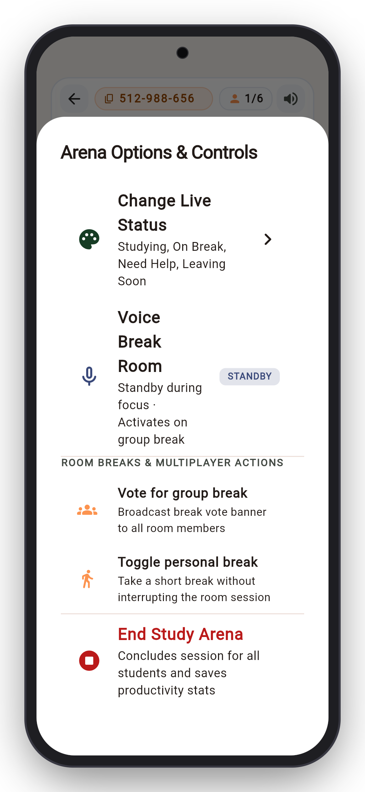
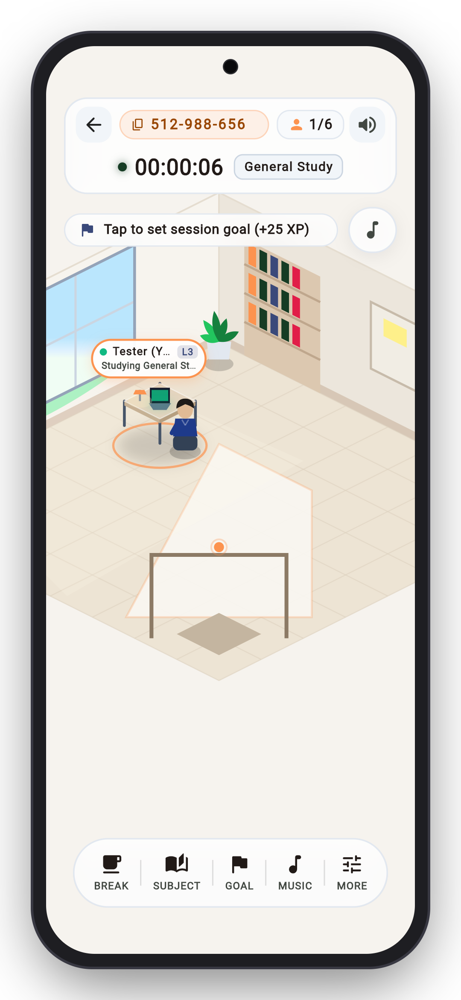
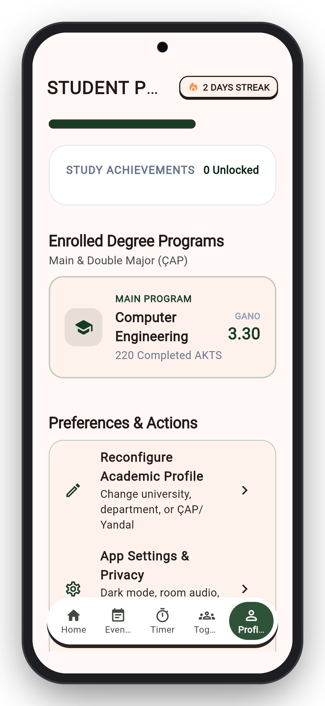
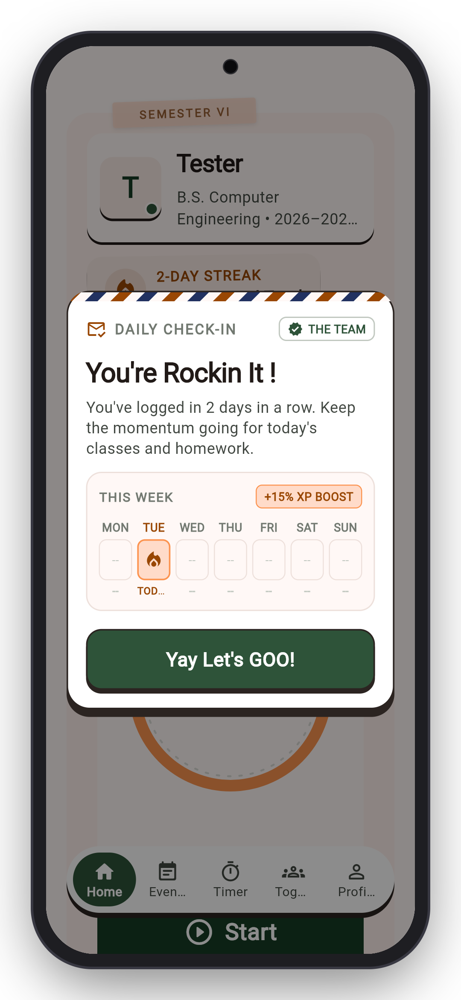

  

  # UniFocus
  **تطبيق الحياة الأكاديمية والاجتماعية**

  

    
    
    
    
    
    
  

  

    <a href="README.md">Türkçe</a> • <a href="README_EN.md">English</a> • <b>العربية</b>
  

  

    <a href="#-ما-الذي-يقدمه-unifocus">منظور المستخدم</a> •
    <a href="#️-التقنيات-المستخدمة">التقنيات المستخدمة</a> •
    <a href="#-بيئة-الدراسة-25d-وهندسة-الرسم">غرفة الدراسة 2.5D</a> •
    <a href="#-المحرك-الأكاديمي-وحساب-المعدل-التراكمي">المحرك الأكاديمي</a> •
    <a href="#-التحفيز-وألعاب-الاستراحة-الجماعية">نظام النقاط والألعاب</a>
  

---

## 🎯 ما الذي يقدمه UniFocus؟

يجمع UniFocus إدارة المسار الأكاديمي، وتنفيذ المهام اليومية، والدراسة الجماعية المباشرة في منصة تعاونية واحدة مصممة لطلاب الجامعات والمدارس على حد سواء.

### 1. لطلاب الجامعات
- **تتبع كامل للتقدم الأكاديمي:** أضف مقرراتك الدراسية، ومعدلك التراكمي الحالي، وساعاتك المعتمدة (ECTS) لمتابعة مسارك الدراسي والحصول على تحليلات دقيقة دون الحاجة لإعادة الحساب يدوياً في كل فصل.
- **دمج التخصص المزدوج والفرعي:** أضف مقررات تخصصك الثاني أو الفرعي جنباً إلى جنب مع تخصصك الأساسي لمتابعة خطتي التخرج في وقت واحد.
- **دعم أنظمة التقييم المتعددة:** مرونة مدمجة للتوافق مع سلالم الدرجات الجامعية ومصفوفات الأحرف المعتمدة.
- **لوحات شرف جامعية:** نافس زملاءك في جامعتك عبر ترتيب أسبوعي يعتمد على ساعات التركيز الموثقة والأهداف المنجزة.

### 2. لطلاب المدارس
- **تخصيص المناهج المدرسية:** أضف موادك المدرسية، وسنتك الدراسية، ومدرستك لتنظيم مواعيد المذاكرة.
- **قوائم تنافسية للطلاب:** قارن التزامك وساعات مذاكرتك مع زملائك من مدرستك ومختلف المدارس الأخرى.

### 3. ميزات أساسية لجميع الطلاب
- **مؤقتات تركيز متقدمة:** جلسات بومودورو قابلة للتخصيص لبناء عادات دراسية عميقة ومنتظمة.
- **إدارة المهام حسب الأولوية:** ترتيب الواجبات، والمشاريع، ومواعيد التسليم وفق درجات الأهمية.
- **سلسلة الالتزام اليومي (Streak):** الحفاظ على عادة الدراسة اليومية واستمرار عداد الأيام المتتابعة.

### 4. الدراسة الجماعية: غرفة دراسة افتراضية 2.5D مع أصدقائك
- **غرف دراسة حية:** اجمع أصدقاءك في غرفة دراسة افتراضية مشتركة عبر رمز مكوّن من 9 أرقام (`XXX-XXX-XXX`).
- **حالات تركيز تفاعلية:** اعرض المادة التي تدرسها أو حالة الاستراحة؛ حيث يتحرك مجسمك الافتراضي ليجلس على المكتب أو يقف ويغادر الغرفة وفق حالتك الآنية.
- **استراحة جماعية وصوت حي:** عند تصويت الغرفة لأخذ استراحة، ينتقل الجميع إلى صالة الاستراحة للتحدث عبر قناة صوتية منخفضة الكمون عبر WebRTC.
- **قائمة انتظار موسيقية متزامنة:** اختر واستمع لمقاطع Lo-Fi متزامنة بالثانية بين جميع الحاضرين، مع قائمة تشغيل تفاعلية لتنسيق المسارات القادمة.
- **ألعاب استراحة خفيفة:** جدد طاقتك مع أصدقائك عبر مسابقات معلومات عامة سريعة، ومسائل حساب ذهني، وبطاقات ذاكرة، وتحديات كلمات.
- **تحديات الاستراحة الصحية:** احرص على راحة جسدك أثناء الاستراحة بإتمام مهام واقعية كشرب الماء أو إراحة عينيك من الشاشة واكسب نقاط خبرة إضافية.

  
  
<i>خيارات إدارة الغرفة في الوقت الفعلي، وتحديث الحالة، والتجهيز للصوت التفاعلي.</i>

---

## 🛠️ التقنيات المستخدمة

تم بناء UniFocus بالكامل عبر استغلال قدرات الرسم الهندسي الأصيلة في Flutter والبنية السحابية التفاعلية دون الاعتماد على محركات ألعاب خارجية أو متصفحات مدمجة:

| المجال | التقنية | سبب الاختيار الهندسي |
| :--- | :--- | :--- |
| **واجهة المستخدم** | **Flutter / Dart** | ترجمة برمجية أصلية موحدة للأداء السلس على Android و iOS. |
| **محرك الرسم 2.5D** | **Flutter `CustomPainter` / Canvas** | رسم هندسي متكامل للمجسمات بالمتجهات (Vectors) بمعدل 60 إطاراً في الثانية دون الحاجة لمحركات ألعاب خارجية (Flame/Unity) أو صور مجزأة. |
| **قاعدة البيانات والتزامن** | **Google Cloud Firestore** | تزامن لحظي ثنائي الاتجاه لحالة المقاعد، وجود الأعضاء، المهام، وطوابع تشغيل الموسيقى. |
| **المصادقة والأمان** | **Firebase Auth ونظام التوكن المزدوج** | توكن وصول مؤقت في الذاكرة مع توكن تجديد مشفر في التخزين الآمن وتجديد صامت تلقائي. |
| **الصوت المباشر (WebRTC)** | **LiveKit Cloud & WebRTC SFU** | نقل صوتي عالي النقاء لصالة الاستراحة مع ميزة إلغاء الصدى والتقاط مستوى الصوت الحقيقي من الميكروفون. |
| **خادم إصدار تصاريح الصوت** | **Render (Node.js/Go)** | خدمة مصغرة تتحقق من هوية مستخدم Firebase وتصدر تصاريح LiveKit المشفرة. |
| **محرك مزامنة الموسيقى** | **حساب الفارق الزمني على العميل** | مسارات Lo-Fi مدمجة تتزامن وفق التوقيت المرجعي في Firestore مع حلقة تدقيق كل 5 ثوانٍ لتعديل أي انزياح يتجاوز 3 ثوانٍ. |

---

## 📐 بيئة الدراسة 2.5D وهندسة الرسم

يعتمد رسم الغرفة بالكامل على مسقط متساوي القياس بنسبة 2:1 عبر معادلات التحويل التالية:

$$\text{screenX} = \text{originX} + (x - y) \times \frac{\text{tileWidth}}{2}$$
$$\text{screenY} = \text{originY} + (x + y) \times \frac{\text{tileHeight}}{2} - z$$

- **ترتيب العمق الديناميكي (Depth Sorting):** إعادة ترتيب المكاتب والشخصيات في كل إطار رسم لمنع أي تداخل بصري خاطئ بين العناصر:
  $$\text{depth} = (x + y) \times 100 + z$$
- **توزيع المقاعد الحتمي:** ترتيب ملء مقاعد الغرفة الستة بالتسلسل `[0, 3, 1, 4, 2, 5]` لضمان تباعد الطلاب قبل ازدحام الغرفة.
- **حركة المشي والتنفس البرمجية:** استخدام دوال جيبية رياضية (Sine Waves) لمحاكاة خطوات المشي، مع حركة اهتزاز بسيطة للشخصيات الجالسة ($\pm 1.4\text{px}$) كل 2.8 ثانية لمحاكاة التنفس والكتابة.

  
  
<i>غرفة دراسة بالرسم المتجهي عبر Canvas مع فرز العمق ومؤقتات التركيز المباشرة.</i>

---

## 📊 المحرك الأكاديمي وحساب المعدل التراكمي

معادلة احتساب المعدل التراكمي مع حفظ الإنجازات السابقة:

$$\text{المعدل التراكمي} = \frac{(\text{baselineGpa} \times \text{baselineAkts}) + \sum (\text{نقاط\_المادة} \times \text{ساعات\_المادة})}{\text{baselineAkts} + \sum \text{ساعات\_المواد\_المنجزة}}$$

*بالنسبة لطلاب السنة التحضيرية أو المستجدين الذين لم تصدر نتائجهم بعد، تظل قيمة `baselineGpa` غير محددة (`null`)، وتظهر في الواجهة **`لم يُحدد المعدل`** بدلاً من إظهار `0.00` الخاطئة.*

  
  
<i>لوحة تتبع أكاديمي تدعم التخصص الرئيسي، والتخصص المزدوج (ÇAP)، والفرعي في آنٍ واحد.</i>

---

## 🎮 التحفيز وألعاب الاستراحة الجماعية

يتم تسجيل نقاط الخبرة (XP) بعمليات غير قابلة للتكرار العبثي عبر مفاتيح فريدة (`idempotencyKey`):

| النشاط المنجز | نقاط الخبرة المكتسبة |
| :--- | :---: |
| إتمام مهمة عادية | +10 XP |
| إتمام مهمة عالية الأهمية | +15 XP |
| جلسة تركيز (25–30 دقيقة) | +25 XP |
| جلسة تركيز (50–60 دقيقة) | +50 XP |
| جلسة تركيز عميق (90+ دقيقة) | +75 XP |
| تحقيق الهدف اليومي (4 جلسات) | +30 XP |
| جلسة دراسة مشتركة في الغرفة | +25 XP |
| حوافز استمرارية السلسلة (7 أيام / 30 يوماً) | +50 / +200 XP |

### ألعاب الاستراحة التفاعلية المتزامنة
1. **Quick Quiz:** مسابقة معلومات عامة وأكاديمية سريعة من 3 جولات.
2. **Fast Math:** اختبار العمليات الحسابية الذهنية السريعة في وقت محدد.
3. **Word Challenge:** فك ترتيب الحروف وإيجاد الكلمات والأنغرام.
4. **Memory Match:** اختبار قوة الذاكرة وتذكر تسلسل العناصر والألوان.

  
  
<i>نافذة تسجيل الدخول اليومي لمتابعة سلسلة الأيام المتتابعة وحوافز نقاط الخبرة المضاعفة.</i>

---

## 🤝 الدعم والتعاون المجتمعي

  
  &nbsp;
  
  &nbsp;
  
  &nbsp;
  

### 🌟 ادعم المشروع
هذا التطبيق ما زال في مراحله الأولى وتطويره مستمر. دعمكم يمثل حافزاً كبيراً لنا لتطويره وإضافة ميزات جديدة باستمرار. يسعدنا دعمك بوضع نجمة ⭐ للمستودع لمساعدة المشروع في الوصول إلى المزيد من الطلاب!
