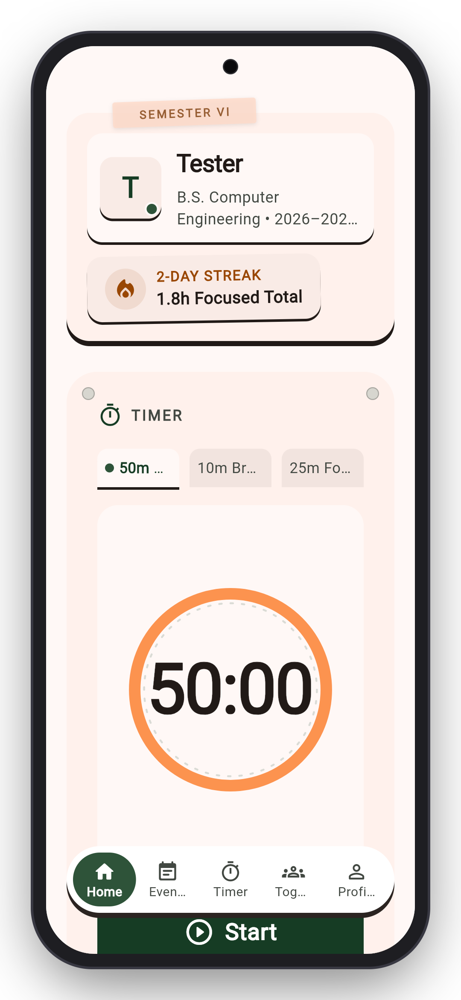
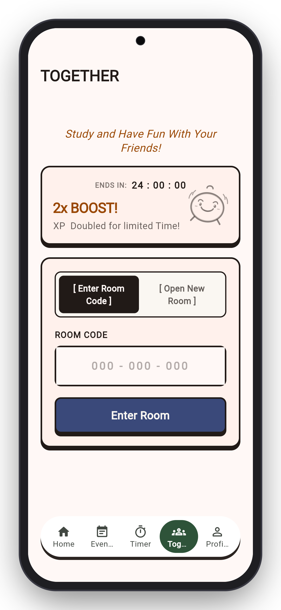

  

  # UniFocus
  **Academic & Social Productivity Platform**

  

    
    
    
    
    
    
  

  

    <a href="README.md">Türkçe</a> • <b>English</b> • <a href="README_AR.md">العربية</a>
  

  

    <a href="#-user-perspective">User Perspective</a> •
    <a href="#️-technology-stack">Tech Stack</a> •
    <a href="#-25d-isometric-workspace-architecture">2.5D Room Engine</a> •
    <a href="#-academic-engine--gpa-matrix">Academic Engine</a> •
    <a href="#-gamification--break-mini-games">Gamification</a> •
    <a href="#-performance-load--concurrency-testing">Performance & Tests</a>
  

---

## 🎯 User Perspective

UniFocus integrates curriculum tracking, daily task organization, and real-time multiplayer co-working into a unified collaboration platform built for both university and school students.

### 1. For University Students
- **Holistic Academic Trajectory:** Enter ongoing coursework, current cumulative GPA, and completed ECTS credits to track graduation milestones and academic analytics without rebuilding spreadsheets every term.
- **Double Major & Minor Integration:** Run a primary curriculum alongside a secondary double-major or minor program, tracking dual degree trajectories simultaneously.
- **Custom Grading Scales:** Fully compatible with custom institutional letter-grade scales and evaluation matrices.
- **Campus Leaderboards:** Compete with campus peers on verified study durations and completed milestones.

### 2. For School Students
- **Tailored Curricula:** Configure grade-level coursework and school institutions with zero boilerplate.
- **Comparative Rankings:** Benchmark regular focus hours against students across your school and regional institutions.

### 3. Core Capabilities for All Learners
- **Configurable Focus Timers:** Customizable Pomodoro cycles designed to foster deep work sessions.
- **Prioritized Task Backlog:** Organize assignments, laboratory prep, and exams by strict priority weighting.
- **Daily Streak Tracking:** Reinforce disciplined daily study routines with streak preservation incentives.

  
  
<i>Home Dashboard</i>

### 4. Co-Working: 2.5D Virtual Study Rooms
- **Real-Time Collaboration Spaces:** Assemble study groups via 9-character room codes (`XXX-XXX-XXX`) inside a shared 2.5D virtual space.
- **Visual Status Reflection:** Avatars sit at workstations during active study or dynamically walk toward the doorway during short breaks.
- **Group Consensus Breaks & Voice Chat:** Once quorum is achieved for a break, members enter the lounge with low-latency WebRTC-powered voice chat.
- **Synchronized Audio Queue:** Stream synchronized lo-fi audio tracks across all connected room participants with zero jitter.
- **Social Break Mini-Games:** Re-energize with synchronized quick quizzes, mental arithmetic, memory cards, and word challenges.
- **Wellness Habits:** Gain bonus XP by confirming physical wellness tasks like hydration and screen-fatigue eye relief.

  
  
  
<i>Left: Lobby    Right: Room Controls</i>

---

## 🛠️ Technology Stack

UniFocus eschews heavy third-party game frameworks in favor of Flutter's native vector canvas and reactive cloud microservices:

| Domain | Technology | Justification |
| :--- | :--- | :--- |
| **Frontend & UI** | **Flutter / Dart** | Single codebase compiled natively to high-performance Android and iOS binaries. |
| **2.5D Graphics Engine** | **Pure Flutter `CustomPainter` / Canvas** | 60 FPS isometric vector rendering without Flame, Unity, or pre-rendered sprite assets. |
| **State Management** | **Native `ChangeNotifier` + Reactive Streams** | Zero external state crates; memory-leak-safe, highly deterministic event-driven reactivity. |
| **Data Sync & State** | **Google Cloud Firestore** | Bidirectional snapshot listeners for seat claims, user presence, tasks, and audio timestamps. |
| **Auth & Security** | **Firebase Auth & Dual-Token Architecture** | In-memory short-lived access tokens paired with secure rotating refresh tokens. |
| **Real-Time Audio** | **LiveKit Cloud & WebRTC SFU** | Sub-second multi-peer audio featuring hardware acoustic echo cancellation (AEC) and VAD. |
| **Token Microservice** | **Render (Node.js)** | Verifies Firebase identity and signs cryptographic LiveKit JWT keys (stress-tested via k6 at 250 VUs). |
| **Audio Sync Loop** | **Client-Side Timestamp Algorithm** | Polling loop checking every 5 seconds to correct clock drift exceeding 3 seconds without player restart. |

---

## 📐 2.5D Isometric Workspace Architecture

The workspace utilizes a custom vector rendering engine based on 2:1 dimetric projection mathematics:

$$\text{screenX} = \text{originX} + (x - y) \times \frac{\text{tileWidth}}{2}$$
$$\text{screenY} = \text{originY} + (x + y) \times \frac{\text{tileHeight}}{2} - z$$

- **Dynamic Depth Sorting:** Every frame recalculates Z-indexing to prevent visual overlap across desks and moving avatars:
  $$\text{depth} = (x + y) \times 100 + z$$
- **Deterministic Seat Allocation:** 6 workstation desks are claimed in sequence `[0, 3, 1, 4, 2, 5]` to preserve a minimum $100\text{px}$ aisle clearance.
- **Procedural Kinematics:** Procedural sine-wave walking kinematics replace sprite loops, paired with subtle resting breathing oscillations ($\pm 1.4\text{px}$).

  
  
<i>Room UI Design</i>

---

## 📊 Academic Engine & GPA Matrix

A cumulative ECTS-weighted engine that removes the requirement of entering past semesters individually:

$$\text{Cumulative GPA} = \frac{(\text{baselineGpa} \times \text{baselineAkts}) + \sum (\text{course.gradeWeight} \times \text{course.ects})}{\text{baselineAkts} + \sum \text{completedCourse.ects}}$$

*For preparatory class students or unpublished grades, `baselineGpa` evaluates to `null`, rendering **`NOT RECORDED`** rather than a deceptive `0.00`.*

  
  
<i>Profile Tab</i>

---

## 🎮 Gamification & Break Mini-Games

XP gains are written to cloud storage via unique client transaction keys (`idempotencyKey`) to prevent replay exploits:

| Activity | XP Granted |
| :--- | :---: |
| Standard Task Completion | +10 XP |
| High-Priority Task | +15 XP |
| 25–30 Minute Focus Interval | +25 XP |
| 50–60 Minute Focus Interval | +50 XP |
| 90+ Minute Deep Work Session | +75 XP |
| Daily Goal Bonus (4 Completed Sessions) | +30 XP |
| Group Co-Working Session | +25 XP |
| 7-Day / 30-Day Streak Milestone | +50 / +200 XP |

### Synchronous Break Mini-Games
1. **Quick Quiz:** 3-round rapid academic trivia challenge.
2. **Fast Math:** Timed mental calculation and arithmetic agility.
3. **Word Challenge:** Anagram puzzles and vocabulary derivation.
4. **Memory Match:** Short-term visual pattern and sequence recall.

  
  
<i>Daily Check-in Window</i>

---

## 🚀 Performance, Load & Concurrency Testing

UniFocus's backend microservices, real-time Firestore synchronization, and 2.5D rendering pipeline have been verified under simulated multi-peer concurrency:

### 1. Token Server Load Testing (`k6`)
The LiveKit JWT token-signing microservice on Render (`POST /getLiveKitToken`) was benchmarked using **k6** through a 4-stage ramping profile reaching **250 concurrent Virtual Users (VUs)** across 15 simulated active rooms:

| Metric | Target Threshold | Measured Result | Status |
| :--- | :---: | :---: | :---: |
| **Total HTTP Requests** | — | **23,347 requests** (97 req/sec sustained) | PASS |
| **Request Success Rate** | $> 99.00\%$ | **100.00%** (0 failures out of 23,347) | **PERFECT** |
| **Validation Checks** | $100\%$ | **46,694 / 46,694 passed** | **PERFECT** |
| **Latency $p(95)$** | $< 500\text{ ms}$ | **$260.34\text{ ms}$** | **PASSED** |
| **Latency $p(99)$** | $< 1000\text{ ms}$ | **$480.29\text{ ms}$** | **PASSED** |
| **Median Latency ($p50$)** | Baseline | **$230.83\text{ ms}$** | **HEALTHY** |

> **Event Loop Analysis:** Under peak load, the single-threaded Node.js event loop exhibited zero socket backpressure, maintaining sub-300ms round-trips without dropped connections.

### 2. Firestore State & Concurrency Verification (`Flutter Integration Tests`)
Room lifecycle and multi-peer synchronization were validated via automated Dart test suites:
- **Deterministic Collision-Free Desks:** Verified slot allocation sequence `[0, 3, 1, 4, 2, 5]` maintains $\ge 100\text{px}$ aisle clearance on the canvas, eliminating overlapping avatars.
- **Quorum Consensus & Group Transitions:** Automated tests confirmed that once a $\ge 50\%$ break vote is met, the room document triggers a synchronous viewport state transition across all connected peers within a single frame.
- **Client-Side Media Drift Compensation:** Evaluated the 5-second polling loop against simulated clock skew, verifying that playback drift exceeding $\pm 3\text{s}$ is corrected seamlessly without player restart.

---

## 🤝 Community & Support

  
  &nbsp;
  
  &nbsp;
  
  &nbsp;
  

### 🌟 Support This Initiative
UniFocus is under active continuous development. Star ⭐ the repository to support ongoing feature milestones and help it reach student learners worldwide!
