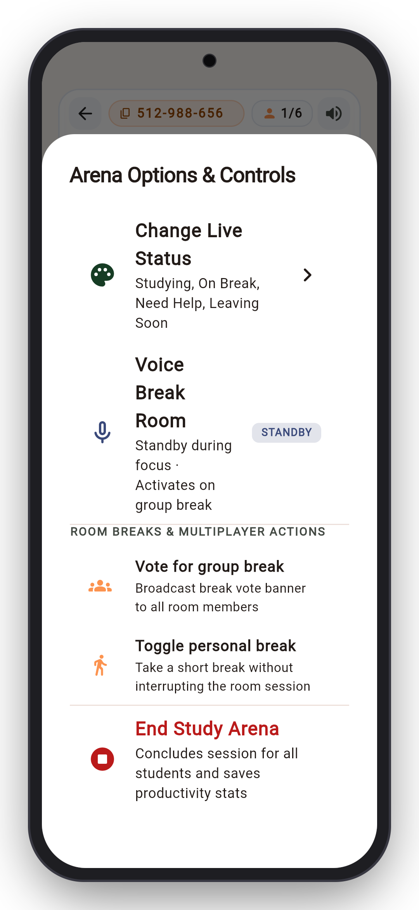
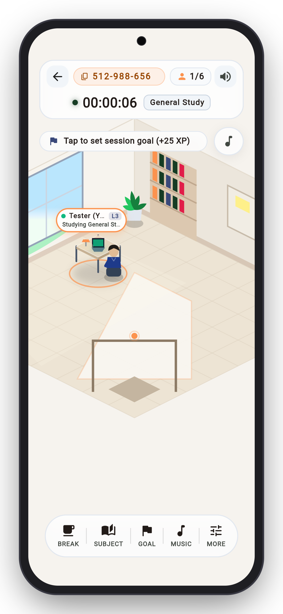
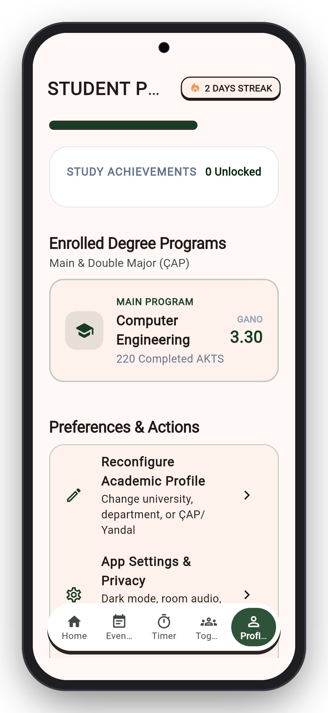
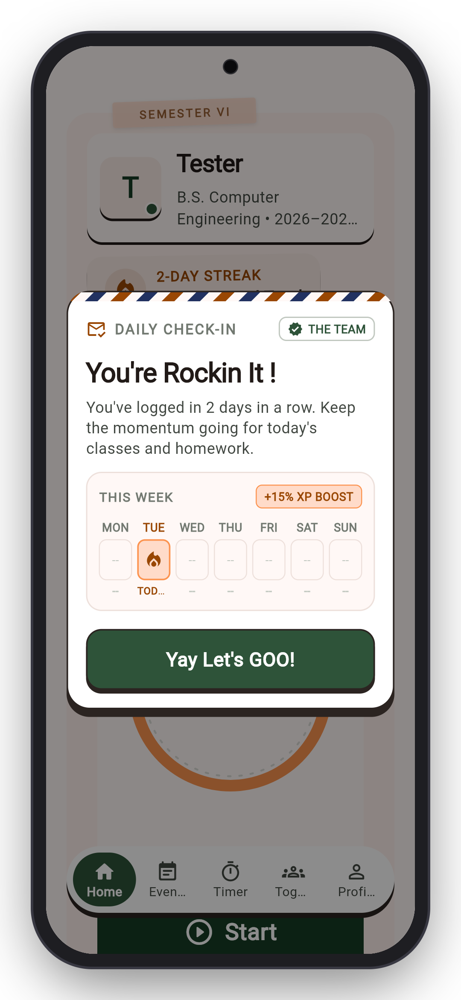

  

  # UniFocus

  **Academic And Social Life App**

  

    

    

    

    

    

    

  

  

    <a href="README.md">Türkçe</a> • <b>English</b> • <a href="README_AR.md">العربية</a>

  

  

    <a href="#-what-unifocus-delivers">User Perspective</a> •

    <a href="#️-technologies-used">Technologies Used</a> •

    <a href="#-25d-isometric-study-room-architecture">2.5D Study Room</a> •

    <a href="#-academic-engine--gpa-calculation">Academic Engine</a> •

    <a href="#-gamification-and-break-mini-games">Gamification & Mini-Games</a>

  

---

## 🎯 What UniFocus Delivers

UniFocus integrates degree management, daily task execution, and real-time multiplayer studying into a single collaborative workbench designed for both university and school students.

### 1. For University Students

**Track Your Full Academic Standing:** Add your coursework, current GPA, and completed ECTS credits to track your degree progression and gain actionable insights without recalculating every semester from scratch.
**Double Major & Minor Integration:** Enroll extra courses from your secondary program side-by-side with your primary major to track both graduation roadmaps simultaneously.
**Multiple Grading System Support:** Built-in flexibility for university grading scales and letter matrices.
**Campus Leaderboards:** Compete against peers from your own university with rankings based on verified focus effort and completed academic milestones.

### 2. For School Students

**Customized School Curriculum:** Easily add your school subjects, academic year, and institution.
**Student Leaderboards:** Measure your consistency and study time against other students across schools.

### 3. Core Features for All Students

**Advanced Focus Timers:** Configurable focus cycles to build deep concentration routines.
**Priority Task Management:** Organize homework, projects, and deadlines by urgency.
**Daily Streak Tracking:** Build lasting habits and keep your consecutive daily study counter growing.

### 4. Study Together: Virtual Study Room With Your Friends

**Live Study Rooms:** Gather your friends into a shared 2.5D virtual study room using 9-digit room codes (`XXX-XXX-XXX`).
**Visual Focus States:** Display what you are currently working on (such as specific subjects or taking a brief rest). Your avatar physically moves, sits, or walks depending on your real-time status.
**Group Breaks & Voice Lounge:** When the room votes for a break, all participants enter the Break Lounge together to chat using an ultra-low-latency WebRTC voice channel.
**Collaborative Music Queue:** Choose and stream lo-fi tracks in sync across all participants, backed by a dynamic shared queue that schedules incoming tracks seamlessly.
**Break Mini-Games:** Refresh your mind with friends through light trivia quizzes, quick mental math, memory cards, or anagram word puzzles.
**Offline Wellness & Rest Challenges:** Take care of your body during breaks by completing real-world tasks—like drinking water or resting your eyes from screen strain—and earn bonus XP for maintaining healthy habits.

  

  
<i>Real-time room options, live status toggle, and voice lounge standby.</i>

---

## 🛠️ Technologies Used

UniFocus relies on pure Flutter vector painting and reactive cloud infrastructure rather than third-party game engines or embedded browsers:

| Domain | Technology | Engineering Rationale |

| :--- | :--- | :--- |

| **Frontend & UI** | **Flutter / Dart** | High-performance native compilation for Android and iOS from a single codebase. |

| **2.5D Graphics Engine** | **Pure Flutter `CustomPainter` / Canvas** | Zero external game engines (Flame, Unity) or raster sprite sheets. Delivers fluid 60 FPS isometric room rendering via mathematical vector paths. |

| **Database & Realtime Sync** | **Google Cloud Firestore** | Bidirectional synchronization for desk occupancy, member state, tasks, and playback timestamps. |

| **Authentication & Security** | **Firebase Auth & Dual-Token Scheme** | Secure session management with short-lived in-memory access tokens and encrypted rotating refresh tokens. |

| **Realtime Voice (WebRTC)** | **LiveKit Cloud & WebRTC SFU** | Low-latency spatial group audio in break lounges with hardware echo cancellation and speech activity detection. |

| **Token Minting Service** | **Render (Node.js/Go)** | Standalone microservice validating Firebase identity tokens before minting cryptographically secure LiveKit passes. |

| **Audio Sync Loop** | **Client-Side Offset Engine** | Bundled offline lo-fi tracks synced via Firestore epoch references and an active 5-second drift sentinel (>3s seek correction). |

---

## 📐 2.5D Isometric Study Room Architecture

The virtual workspace is rendered through canvas mathematics using a 2:1 dimetric projection model:

$$\text{screenX} = \text{originX} + (x - y) \times \frac{\text{tileWidth}}{2}$$

$$\text{screenY} = \text{originY} + (x + y) \times \frac{\text{tileHeight}}{2} - z$$

**Dynamic Depth Sorting:** Every frame re-orders desks and avatars via an isometric composite key to avoid z-fighting artifacts:
  $$\text{depth} = (x + y) \times 100 + z$$

**Deterministic Workstation Allocation:** The 6 workstations are populated in the sequence `[0, 3, 1, 4, 2, 5]` to balance spacing across the room.
**Procedural Walk Cycles & Idle Breathing:** Character stepping utilizes sine-wave vertical offsets; seated avatars employ a 2.8-second loop oscillating $\pm 1.4\text{px}$ to simulate natural breathing and typing.

  

  
<i>Pure Canvas vector room with dynamic depth sorting and real-time focus timers.</i>

---

## 📊 Academic Engine & GPA Calculation

Calculates cumulative GPA without erasing pre-existing academic history:

$$\text{Cumulative GPA} = \frac{(\text{baselineGpa} \times \text{baselineAkts}) + \sum (\text{course.gradePoints} \times \text{course.akts})}{\text{baselineAkts} + \sum \text{gradedCourse.akts}}$$

*For preparatory year students or freshmen without posted grades, `baselineGpa` defaults to `null`, displaying **`GPA NOT SET`** rather than a deceptive `0.00`.*

  

  
<i>Integrated degree tracking supporting Single Major, Double Major (ÇAP), and Minor programs.</i>

---

## 🎮 Gamification and Break Mini-Games

XP rewards are locked to verifiable actions via client-independent idempotency keys (`idempotencyKey`):

| Activity | XP Awarded |

| :--- | :---: |

| Standard Task Completion | +10 XP |

| High-Priority Task Completion | +15 XP |

| 25–30 Minute Focus Sprint | +25 XP |

| 50–60 Minute Focus Sprint | +50 XP |

| 90+ Minute Deep Focus Sprint | +75 XP |

| Daily Goal Completion (4 Sprints) | +30 XP |

| Study Together Session | +25 XP |

| 7-Day / 30-Day Streak Milestones | +50 / +200 XP |

### Synchronized Break Mini-Games

**Quick Quiz:** 3-round rapid academic and general trivia face-off.
2. **Fast Math:** Timed mental arithmetic drills.

3. **Word Challenge:** Anagram solving and vocabulary puzzles.

4. **Memory Match:** Short-term visual pattern and sequence recall.

  

  
<i>Daily check-in modal tracking consecutive study streaks and XP multipliers.</i>

---

## 🤝 Support & Collaboration

  

  &nbsp;

  

  &nbsp;

  

  &nbsp;

  

### 🌟 Show Your Support

This App is in its early staging. Your support will be a great motivation for us to enhance it more and add extra features. Consider giving the repository a star ⭐ — it helps the project reach more students!

